

<a href="https://www.nikshithnooka.page/"></a>

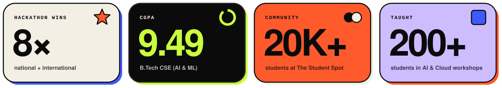

<a href="https://github.com/nikshith-nooka/GovMed-AI"></a><a href="https://github.com/nikshith-nooka/GovReason-Rag">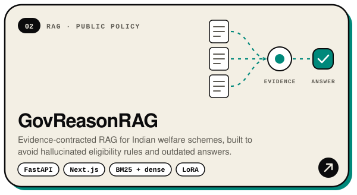</a>
<a href="https://github.com/nikshith-nooka/GeoSick-AI"></a><a href="https://github.com/nikshith-nooka/Marga-Netra-AI"></a>
<a href="https://github.com/nikshith-nooka/PetGuide-AI">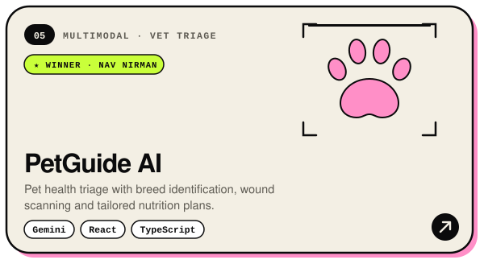</a><a href="https://github.com/nikshith-nooka/GeoTrace-AI"></a>




<a href="https://www.nikshithnooka.page/">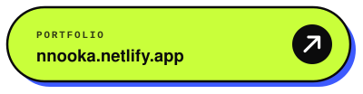</a><a href="https://www.linkedin.com/in/nikshith-nooka/">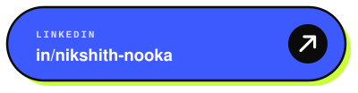</a><a href="mailto:nikshithnooka@gmail.com">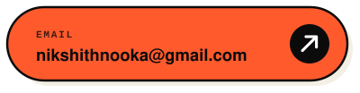</a>

