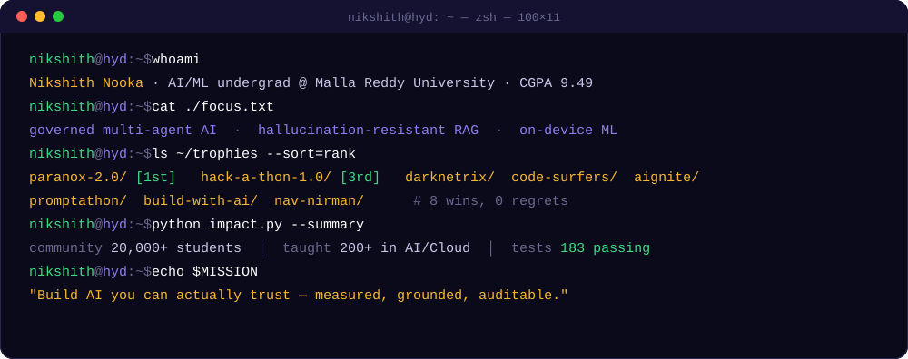

<div align="center">

<a href="https://www.nikshithnooka.page/"></a>

<a href="https://www.nikshithnooka.page/"></a>
<a href="https://www.linkedin.com/in/nikshith-nooka/"></a>
<a href="mailto:nikshithnooka@gmail.com"></a>


</div>

<br/>



<br/>

> [!NOTE]
> **You're not reading a profile. You're reading a model card.**
> This README describes `nikshith-v2026`, a human fine-tuned on hackathons, research papers and way too much chai.
> Scroll down: **you can train it yourself.** 👇

---

## 📇 Model Card · `nikshith-v2026`

<table>
<tr><td>

| Field | Value |
|---|---|
| **Architecture** | Human × Transformer-curious |
| **Base model** | B.Tech CSE (AI & ML), Malla Reddy University '27 |
| **Eval score (CGPA)** | `9.49 / 10` |
| **Fine-tuned on** | 8 hackathon wins · 6 roles · 15+ shipped builds |
| **Context window** | 36 hours (hackathon mode) |
| **Inference hardware** | ☕ chai, served in Hyderabad, IN |
| **Languages** | Python · TypeScript · Java · SQL · Telugu · English · Hindi |
| **License** | Open to collabs, research & internships |

</td></tr>
</table>

**Intended use.** Building AI that people can *trust*: multi-agent systems with measurable guardrails, RAG that refuses to hallucinate, and ML that runs privately on-device. Most of it is aimed at health, cities and public services.

**Out-of-scope use.** Shipping demos with no evals. Writing CSS at 4 AM *(it does, under protest)*.

---

## 🧪 Experiments · selected runs

> Every project is an experiment with a hypothesis. Here are the runs that worked.

<table>
<tr>
<td width="50%" valign="top">

#### `exp-01` · 🩺 [GovBench-Clinical](https://github.com/nikshith-nooka/GovMed-AI)
**Hypothesis:** governance layers in clinical multi-agent AI should be *measured*, not assumed.

A benchmark plus clinician workbench that runs cases through a multi-agent LLM pipeline and audits what each layer (grounding verifier, safety validator, consistency checker, attending review) actually changes.

```diff
+ 183 Python tests + 17 UI tests passing
```
`Python` `FastAPI` `React 19` `Multi-Agent` `LLM Evals`

</td>
<td width="50%" valign="top">

#### `exp-02` · 🏛️ [GovReasonRAG](https://github.com/nikshith-nooka/GovReason-Rag)
**Hypothesis:** naive RAG fails on public policy, but evidence contracts can fix it.

Evidence-Contracted Policy Reasoning (ECPR) for Indian welfare schemes. It targets hallucinations, eligibility-boundary errors and temporal policy drift.

```diff
+ Hybrid retrieval: dense BGE + BM25, fused with RRF
```
`FastAPI` `Next.js 14` `Ollama` `LoRA`

</td>
</tr>
<tr>
<td width="50%" valign="top">

#### `exp-03` · 🌍 [GeoSick AI](https://github.com/nikshith-nooka/GeoSick-AI)
**Hypothesis:** health intelligence can be private, *offline* and still useful.

Turns environmental signals and symptoms into actionable guidance, with the model running **in your browser**.

```diff
+ 🏆 Winner: Darknetrix · Code Surfers
```
`ONNX Runtime Web` `PyTorch` `React 19` `PWA`

</td>
<td width="50%" valign="top">

#### `exp-04` · 🚦 [MargaNetra](https://github.com/nikshith-nooka/Marga-Netra-AI)
**Hypothesis:** a city's traffic grid is a graph, so model it like one.

A decision-support brain and command center for dense urban traffic, built for Neurax Hackathon 3.0 (AI in Smart Cities).

```diff
+ Graph Neural Network traffic intelligence
```
`PyTorch GNN` `TypeScript` `React 19` `Tailwind 4`

</td>
</tr>
</table>

<details>
<summary><b>📂 more runs in <code>./experiments/</code></b></summary>
<br/>

| Run | What it does | Stack |
|---|---|---|
| 🐾 [PetGuide AI](https://github.com/nikshith-nooka/PetGuide-AI) | Multimodal vet triage, breed ID, wound scanning. 🏆 Nav Nirman winner | Gemini 2.5 Flash · React 19 |
| 🛰️ [GeoTrace AI](https://github.com/nikshith-nooka/GeoTrace-AI) | Planetary atmospheric intelligence on a 3D globe | TypeScript · Vite · WebGL |
| ♻️ [Plastivize AI](https://github.com/nikshith-nooka/Plastivize-AI) | CV plastic sorting (PET / HDPE) with gamified rewards | Next.js · PyTorch · MongoDB |
| ✨ [Fashion Fusion](https://github.com/nikshith-nooka/Fashion-Fusion-AI) | Multimodal AI stylist and digital wardrobe | Google GenAI · Firebase |
| 🌿 [MindBalance AI](https://github.com/nikshith-nooka/MindBalance-AI) | Privacy-first mental-health companion | Gemini 2.5 Flash · React |
| 🍿 [Smart Snack Predictor](https://github.com/nikshith-nooka/Smart-Snack-Predictor) | Tree-based classifier for snack healthiness | Scikit-learn · Next.js |
| 🏠 [Fermor](https://github.com/nikshith-nooka/Fermor) | Homepage rebuild with tested pricing logic | Next.js App Router · Tailwind v4 |

</details>

---

## 🎮 Train me · a live model you train by clicking

> **This is a real, community-trained run.** Each button opens an issue. A GitHub Action reads it, takes a training step, redraws the loss curve below and commits the result to this README.
> Push the loss under `0.05` and your name goes into the **Hall of Convergence** forever.

<!-- TRAIN:START -->
<div align="center">



**Run #1** · epoch **0** · loss **`2.5000`** · accuracy **`8.2%`**

`░░░░░░░░░░░░░░░░░░░░░░░░` 0% to convergence

<a href="https://github.com/nikshith-nooka/nikshith-nooka/issues/new?title=train%7Cstep&body=Just%20hit%20%2A%2ASubmit%20new%20issue%2A%2A%20%E2%80%94%20a%20GitHub%20Action%20will%20run%20your%20move%20and%20reply%20in%20a%20few%20seconds.%20No%20need%20to%20write%20anything%20%F0%9F%99%8C"></a>
<a href="https://github.com/nikshith-nooka/nikshith-nooka/issues/new?title=train%7Clr&body=Just%20hit%20%2A%2ASubmit%20new%20issue%2A%2A%20%E2%80%94%20a%20GitHub%20Action%20will%20run%20your%20move%20and%20reply%20in%20a%20few%20seconds.%20No%20need%20to%20write%20anything%20%F0%9F%99%8C"></a>
<a href="https://github.com/nikshith-nooka/nikshith-nooka/issues/new?title=train%7Cdropout&body=Just%20hit%20%2A%2ASubmit%20new%20issue%2A%2A%20%E2%80%94%20a%20GitHub%20Action%20will%20run%20your%20move%20and%20reply%20in%20a%20few%20seconds.%20No%20need%20to%20write%20anything%20%F0%9F%99%8C"></a>
<a href="https://github.com/nikshith-nooka/nikshith-nooka/issues/new?title=train%7Cdata&body=Just%20hit%20%2A%2ASubmit%20new%20issue%2A%2A%20%E2%80%94%20a%20GitHub%20Action%20will%20run%20your%20move%20and%20reply%20in%20a%20few%20seconds.%20No%20need%20to%20write%20anything%20%F0%9F%99%8C"></a>

<sub>Click a button → hit <b>Submit new issue</b> → a GitHub Action trains me and updates this README in about 30 s.<br/>
Total epochs trained by the community: <b>0</b> · gradient explosions: <b>0</b> 💥</sub>

</div>

<details>
<summary><b>📜 Rules · recent epochs · leaderboard</b></summary>
<br/>

| Move | Effect |
|---|---|
| 🧠 **Train one epoch** | Safe SGD step. Slow and steady. |
| ⚡ **Crank the learning rate** | Big gains… or the run explodes. |
| 🎲 **Add dropout** | Regularize. Shields the next risky step. |
| 📚 **Feed more data** | Bigger drop, but only once per trainer per run. |

Push the loss below **0.05** to converge the run and enter the **Hall of Convergence** 🏛️

**🕒 Recent epochs**

| When | Move | Trainer | Δ loss |
|---|---|---|---|
| — | *nobody yet. Be the first to train me!* | — | — |

**🏅 Top trainers**

| | Trainer | Epochs |
|---|---|---|
| 🥇 | *your name here* | 0 |

**🏛️ Hall of Convergence:** *No run has converged yet. Will you be the one?*

</details>
<!-- TRAIN:END -->

---

## 📊 Benchmarks · hackathon leaderboard

<div align="center">

| Benchmark | Split | Score | Submission |
|:---|:---:|:---:|:---|
| **Paranox 2.0** · New Delhi | `national` | 🥇 **1st** | Duality AI: real-time object detection |
| **HACK-A-THON 1.0** | `international` | 🥉 **3rd** | eHRS medical-camp assistant |
| **Darknetrix** | `open` | 🏆 **Win** | GeoSick AI: global health analyzer |
| **Code Surfers** | `open` | 🏆 **Win** | GeoSick AI: environmental health |
| **Aignite** | `open` | 🏆 **Win** | Student performance predictor |
| **Promptathon** | `open` | 🏆 **Win** | Ojas AI: NLP inference engine |
| **Build With AI** | `open` | 🏆 **Win** | VanRaksha: forest-fire risk |
| **Nav Nirman** | `open` | 🏆 **Win** | PetGuide AI engine |

<sub><code>pass@8 = 100%</code>: every one of these went from idea to demo in under 36 hours.</sub>

</div>

---

## 📈 Training log · experience

```console
$ tail -f ~/career/training.log
[2025-08] epoch 01 │ Google               │ Campus Ambassador          │ ✓ AI & Cloud workshops → 200+ students
[2025-08] epoch 02 │ ViswamAI             │ AI Developer               │ ✓ end-to-end RAG over 100 GB / 80K+ records
[2025-08] epoch 03 │ Kartavya Solutions   │ AI Developer Intern        │ ✓ LangChain platform unifying 5 models on GCP
[2025-09] epoch 04 │ Swecha (open source) │ Full-Stack Intern          │ ✓ MERN health platform, 300+ patient records
[2026-01] epoch 05 │ The Student Spot     │ Ops & Community Lead       │ ✓ 20K+ students · 100+ partners · 100+ events
[2026-02] epoch 06 │ XYZON Technologies   │ ML Intern                  │ ✓ student-performance prediction pipeline
[  now  ] epoch 07 │ ▌ looking for the next dataset… (internships · research · collabs)
```

---

## 📦 `requirements.txt`

<div align="center">

<br/>


<br/>
<br/>


</div>

---

## 🛰️ Telemetry

<div align="center">


<picture>
  <source media="(prefers-color-scheme: dark)" srcset="https://raw.githubusercontent.com/nikshith-nooka/nikshith-nooka/output/github-snake-dark.svg" />
  <source media="(prefers-color-scheme: light)" srcset="https://raw.githubusercontent.com/nikshith-nooka/nikshith-nooka/output/github-snake.svg" />
  
</picture>

</div>

---

## ⚠️ Known limitations

- May hallucinate that a 36-hour hackathon is enough time for *one more feature*.
- Performance degrades significantly without chai. ☕
- Strong bias toward adding a 3D globe to everything. 🌍
- Overfits to problems with real-world impact. *(Working as intended.)*

---

## 📚 Citation

If this profile helped your hiring pipeline, please cite:

```bibtex
@human{nooka2026,
  title     = {Nikshith Nooka: Building AI You Can Actually Trust},
  author    = {Nooka, Nikshith},
  affiliation = {Malla Reddy University · Google Campus Ambassador · The Student Spot},
  year      = {2026},
  note      = {8x hackathon champion. Open to internships, research and collabs.},
  url       = {https://www.nikshithnooka.page}
}
```

<div align="center">

<sub>⚙️ This README is partly self-updating: the training run, the 3D graph and the snake are all regenerated by GitHub Actions in this repo.</sub>

</div>
